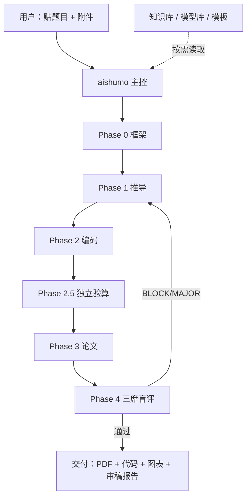

# aishumo · AI 数模主控

> 一个 DeepSeek Harness（DSH）预设 + 方法论技能包：
> **贴题 → 框架 → 推导 → 编码 → 验算 → 论文 → 审稿**，一个预设跑通数学建模竞赛全流程。

作者使用 aishumo 完成 **2026 年高教社杯全国大学生数学建模竞赛 A 题**，获 **全国二等奖**。
（仅作效果背书；获奖论文、赛题求解过程与相关软件不在本仓库公开。）

---

## 它解决什么问题

数学建模竞赛的难点不是“会不会某个算法”，而是：

- 拿到题，怎么快速判断题型、选对模型？
- 推导、代码、图表、论文，怎么保证前后口径一致？
- 代码跑出来的数，怎么证明不是“自说自话”？
- 论文写完，怎么在交卷前发现硬伤？

aishumo 把这些问题固化成**阶段门禁 + 角色分工 + 独立验算 + 三席盲评**，让 AI 按流程交付，而不是一次性生成一篇“看起来像论文”的文本。

---

## 它能交付什么

| 阶段 | 产物 | 门禁 |
|---|---|---|
| Phase 0 框架 | `求解/模型推导/框架设计.md` | 核心思想 / 核心量≤3 / 五问递进 / 命题树 / 题型判定 |
| Phase 1 推导 | 每问一份 `问题X_数学推导.md` | 量纲、假设[强/弱]、方法理由 + 备选方案 |
| Phase 2 编码 | 每问 `问题X_求解.py` + `结果/*.csv` + `图片/*.png` | 必须实际运行，结果/图片非空 |
| Phase 2.5 验算 | 独立验算报告 | 信息隔离复算；分歧 >30% FAIL |
| Phase 3 论文 | `论文/*.tex` + `main.pdf` | xelatex ×2，Error=0；摘要/页数/图表硬检查 |
| Phase 4 审稿 | 三席 scorecard + 聚合结论 | B1-B9 阻断项一票否决；三席盲评 ≥2 轮 |

### 五个角色

| 角色 | 职责 |
|---|---|
| 主控 Lead | 读题、分派、监控、交付、回退协调 |
| 数学家 | 数据预检、深度推导、写推导文件 |
| 工程师 | 写代码、实际运行、产出 CSV/PNG、验算 |
| 作家 | 读推导与结果、写 LaTeX、编译、去 AI 味 |
| 审稿人 | 逐项检查、阻断项否决、证据驱动评审 |

### 质量机制

- **独立验算**：另派 subagent，信息隔离，用不同方法复算关键数值。
- **三席盲评**：旗舰通审 / 创新与决策 / 正确性可复现，三份 scorecard 独立打分。
- **数字冻结**：论文每个数字可追溯到 CSV / 脚本输出，改代码后检测 stale 引用。
- **技术失败止损**：同一 bug 修复 ≥3 次、偏差 >10% 未收敛、出现物理不可能结果 → 停止自试并上报，禁止“把失败说成通过”。
- **学术诚信门控**：抄袭、数据造假、引用伪造、图片伪造、不可复现、匿名性违规、越权署名，任一触发一票否决。

---

## 安装

要求：**DeepSeek Harness（DSH）桌面版**，Windows / macOS / Linux。

```bash
git clone https://github.com/Wangbaoyin1/math-modeling-award.git
cd math-modeling-award

# Windows
powershell -ExecutionPolicy Bypass -File aishumo/install.ps1

# macOS / Linux
bash aishumo/install.sh
```

安装脚本会：

1. 把 `知识库/` 复制到 `~/.dsh/skills/aishumo-method/知识库/`
2. 安装 `aishumo-method` 技能与工具脚本
3. 把 `aishumo` 主控预设写入 `~/.dsh/.agent-presets/aishumo/`
4. 自动替换预设里的知识库/工具绝对路径

安装后**重启 DSH**，新建会话，在预设选择器中选择 **「AI 数模主控（aishumo）」**。

> 不想用安装脚本？也可以手动把 `aishumo/presets/aishumo/` 与 `aishumo/skills/aishumo-method/` 复制到对应目录，并把模板里的 `{{KNOWLEDGE_ROOT}}`、`{{TOOLS_ROOT}}` 替换成实际路径。

---

## 使用

### 全自动跑通

新建会话 → 选「AI 数模主控」→ 直接贴题目 + 数据附件。

```
帮我做这道题，全自动跑通，最后交付论文 PDF 和支撑材料。
```

### 只做某一步

```
只做问题 1 的建模和求解，先不写论文
```

```
已有推导和结果，直接帮我写论文并编译
```

```
已成稿，只跑评审收敛：多视角评审 → 修复 → 终审
```

### 人工把关模式

```
用人工把关模式：每个关键决策点停下来给我编号选项确认，再继续
```

触发词：`人工把关` / `manual` / `逐步` / `分步` / `friendly`。

### 中途续跑

把已有 `求解/` 目录放进工作区，说：

```
继续求解
```

会读取 `求解/进度.md` 从断点继续。

---

## 产出结构

```
<你的题目目录>/
├─ 求解/
│  ├─ 模型推导/
│  │  ├─ 框架设计.md
│  │  └─ 问题X_数学推导.md
│  ├─ 问题X/
│  │  ├─ 问题X_求解.py
│  │  ├─ 结果/*.csv
│  │  └─ 图片/*.png
│  └─ 进度.md
├─ 论文/
│  ├─ main.tex
│  ├─ main.pdf
│  └─ 图片/
└─ 审稿/
   ├─ seat_A_scorecard.md
   ├─ seat_B_scorecard.md
   ├─ seat_C_scorecard.md
   └─ 聚合结论.md
```

---

## 知识库

`知识库/` 是 aishumo 的方法论底座，安装后随技能一起部署：

- **底层逻辑**：建模七步法、框架设计、模型选择、假设合理性、检验与敏感性、结果解释
- **模型工具箱**：优化 / 评价 / 预测 / 图论 / 机理 / 统计 / 随机 / 数据 / 量纲 + 可运行模板
- **图表库**：出版级图函数（含龙卷风图、空间地图、3D 曲面）
- **获奖方法论**：选题决策、降 AI 写法、国奖论文六维拆解、失败模式库
- **论文模板**：`cumcmthesis.cls` + 标准骨架

入口：安装后的 `~/.dsh/skills/aishumo-method/知识库/知识库总导航.md`。

---

## 架构



---

## 常见问题

**必须用 DSH 吗？**
是。aishumo 是 DSH 的 agent 预设 + 技能包，依赖 DSH 的 subagent、todo、terminal 等工具。

**没有 xelatex 怎么办？**
Phase 3 会先探测 xelatex；没有时回退到 matplotlib PDF 排版。建议安装 MiKTeX/TeX Live 以获得正式论文排版。

**会编造数据吗？**
不会。Phase 2 强制代码实际运行、产出 CSV/PNG；Phase 2.5 独立复算；审稿阶段有学术诚信门控。

**和 UltraMath 的关系？**
aishumo 的 Phase 0-4 流程框架参考了 UltraMath（MIT），并注入自研方法论、知识库与审稿规则。详见 `NOTICE.md`。

---

## 许可与致谢

- 代码 / 预设 / 脚本：**MIT**
- 知识库文档：**CC BY-NC 4.0**
- 流程框架参考：[UltraMath / dsh-ultramath](https://github.com/Andiii208/dsh-ultramath)（MIT）
- 论文模板：`cumcmthesis` 作者

详见 [`LICENSE`](../LICENSE) 与 [`NOTICE.md`](../NOTICE.md)。
